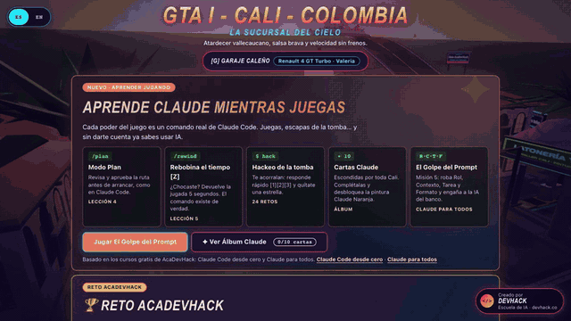
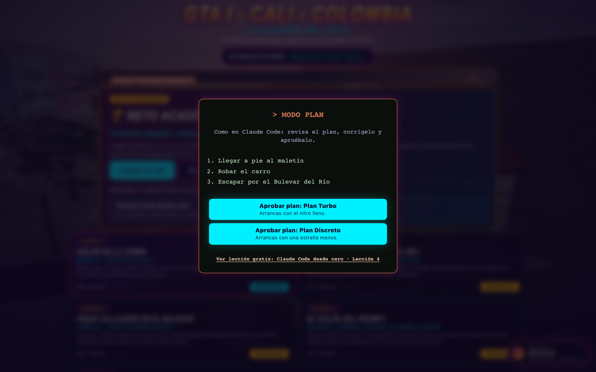
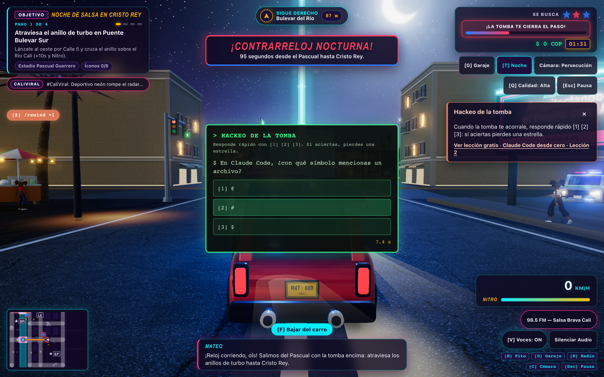
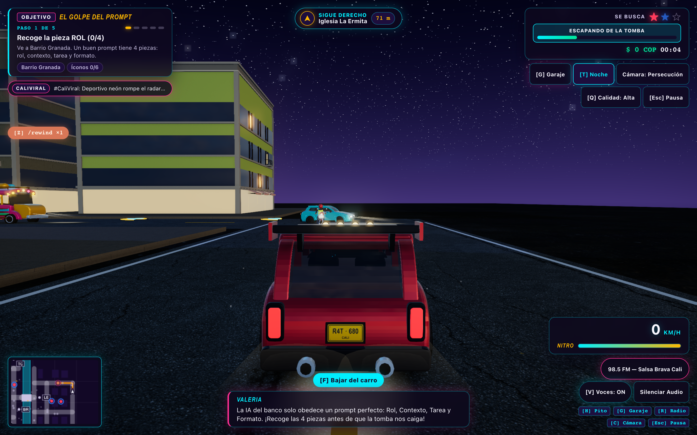
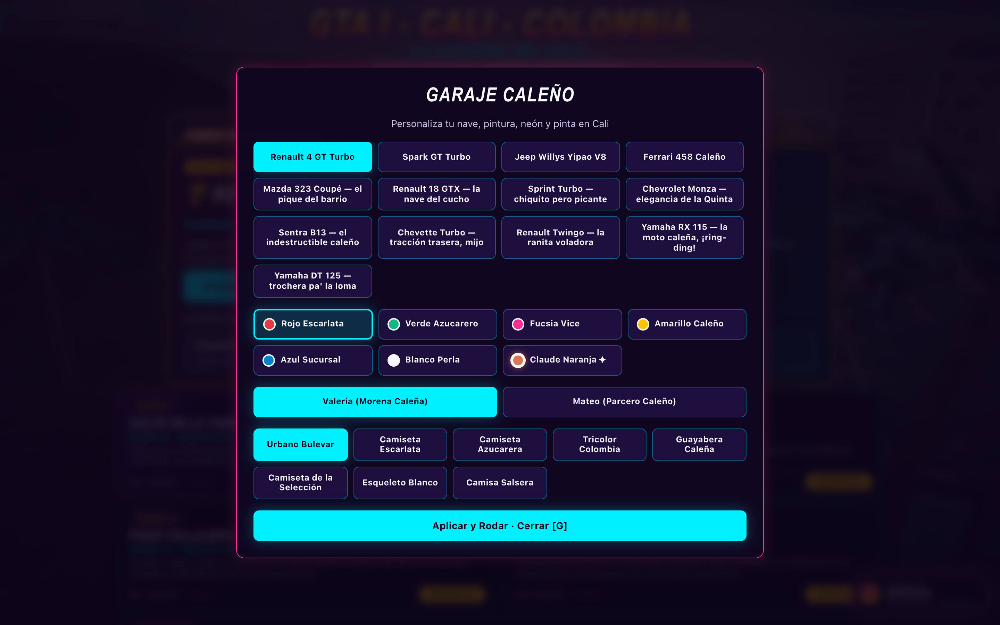
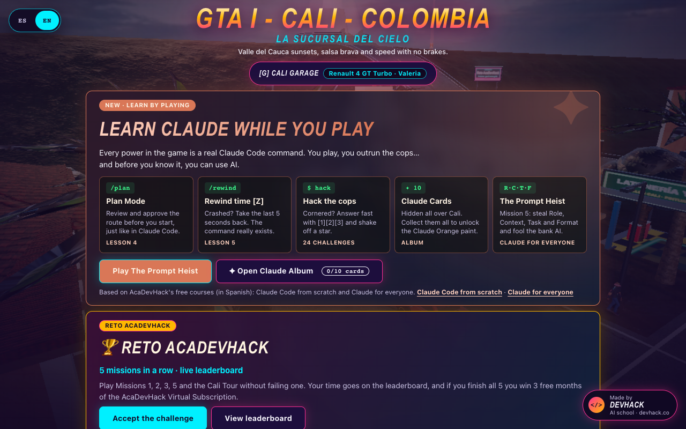
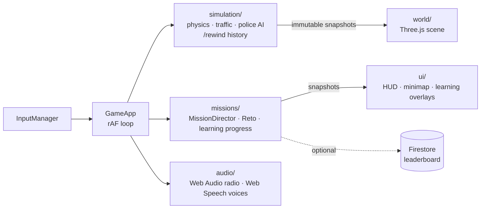

<div align="center">



# 🌴 GTA I - Cali - Colombia

### Learn Claude while you play

**An open-world 3D browser game set in Cali, Colombia, where every power is a real Claude Code command.**<br/>
Outrun the cops, hack your way out of a pursuit and pull off *The Prompt Heist*. By the time you finish, you already know how to work with AI.

[](LICENSE)
[](tsconfig.json)
[](https://threejs.org)
[](https://vite.dev)
[](#-quality)
[](#-quick-start)
[](CONTRIBUTING.md)
[](https://github.com/jggomez/gta-cali-learn-claude/stargazers)

[**▶ Play now**](https://devhack.co/gta-cali-claude?utm_source=github&utm_medium=readme) · [**Quick start**](#-quick-start) · [**What you learn**](#-learn-claude-while-you-play) · [**Missions**](#-missions) · [**Architecture**](#-architecture) · [**Free courses**](https://devhack.co/academy-ai/claude-code-desde-cero/) · [**Español**](README.es.md)

Made in Cali 🇨🇴 by **[DevHack](https://devhack.co)**, the applied-AI school behind **AcaDevHack**.

</div>

---

## Table of contents

- [Why this game?](#-why-this-game)
- [Learn Claude while you play](#-learn-claude-while-you-play)
- [Features](#-features)
- [Missions](#-missions)
- [Reto AcaDevHack (challenge + leaderboard)](#-reto-acadevhack)
- [Quick start](#-quick-start)
- [Controls](#%EF%B8%8F-controls)
- [Architecture](#-architecture)
- [Quality](#-quality)
- [Contributing](#-contributing)
- [Credits & license](#-credits--license)

## 💡 Why this game?

Most people leave an AI course in the first lesson because it *feels like a class*. This game flips that around: every mechanic **is** a Claude Code concept with its real name.
- `/rewind` really rewinds time.
- Plan Mode really asks you to approve a plan before the mission starts.
- To hack the police you answer questions taken from real course exams.

You play first and understand afterwards. Each tip links to a **free lesson** at [AcaDevHack](https://devhack.co) (in Spanish).

## 🧠 Learn Claude while you play


| In the game | What it does | What you actually learn |
|---|---|---|
| **Plan Mode** | Before a mission you review the plan and pick **Turbo** (full nitro) or **Stealth** (one less star) | Claude Code's **Plan mode**: propose before touching code |
| **`/rewind` [Z]** | Crashed? Go back 5 seconds, once per mission | **`/rewind`** undoes Claude's edits |
| **Hack the cops** | Cornered? Answer in 8 s with [1] [2] [3] and lose a wanted star | 24 questions adapted from the course exams |
| **Claude Cards ✦** | 10 cards hidden around Cali unlock the **Claude Orange** paint | Agentic loop, CLAUDE.md, hooks, MCP, subagents, skills, artifacts… |
| **Mission 5 · The Prompt Heist** | Steal **Role, Context, Task and Format** and fool a bank's AI | The 4-part prompt (*Claude for everyone*) |
| **Radio IA 99.1** + phone | Spanish radio ads and tips from *Profe JG* after each mission | Everyday Claude tricks |

None of this can be used to cheat the leaderboard: the mission clock keeps running through rewinds and hacks.

<table>
  <tr>
    <td width="50%"><br/><sub><b>Plan Mode</b>: approve the route before you start</sub></td>
    <td width="50%"><br/><sub><b>Hack the cops</b>: answer right and lose a star</sub></td>
  </tr>
  <tr>
    <td><br/><sub><b>/rewind [Z]</b>: and a tip about the real command</sub></td>
    <td><br/><sub><b>Mission 5</b>: Role, Context, Task, Format</sub></td>
  </tr>
  <tr>
    <td><br/><sub><b>Claude Album</b>: one card per lesson</sub></td>
    <td><br/><sub><b>Garage</b>: unlock Claude Orange with the full album</sub></td>
  </tr>
</table>

## ✨ Features

- **Open-world Cali in 3D**: Torre de Cali, Bulevar del Río, La Ermita, Estadio Pascual Guerrero, Cristo Rey and San Antonio. Sunset and night skies, bloom and cinematic grading.
- **GTA-style gameplay**:
  - wanted stars, police pursuits, roadblocks and Busted screens;
  - carjacking, a Pay 'n' Spray, drifting, nitro and stunt jumps;
  - a GPS minimap.
- **Colombian fleet**: Renault 4, Mazda 323, Chevrolet Sprint, Yamaha RX 115, the *chiva* party bus, MIO buses and more, all with authentic license plates.
- **Sound of Cali**:
  - procedural Salsa Brava and Synthwave radio;
  - V8 and turbo sounds, sirens;
  - characters speaking with Caleño voices (Web Speech `es-CO`).
- **🇺🇸 English or 🇨🇴 Spanish UI**: the `ES | EN` toggle is auto-detected. The city keeps its soul: billboards, news, radio and street shouts stay in Caleño Spanish, and characters speak Spanish with English subtitles.
- **Runs 100% offline**: models, textures, audio and voices are all local. The only network feature is the optional leaderboard.
- **Desktop and mobile**: responsive HUD with 44 px touch targets.



## 🎮 Missions

| # | Mission | What happens |
|---|---|---|
| 1 | **Heist at the Tower** | On-foot heist at Torre de Cali, then a getaway to San Antonio |
| 2 | **Salsa Night at Cristo Rey** | 95-second night time trial through turbo rings |
| 3 | **Street Race on the Bulevar** | Six-checkpoint race with a police ambush |
| 5 | **The Prompt Heist** | Build the perfect prompt and deliver it to the bank's AI |
| — | **Free Roam** | Discover the 6 landmarks and hunt for the Claude Cards |

## 🏆 Reto AcaDevHack

Play **all 5 stages in a row**: M1 → M2 → M3 → M5 → Cali Tour. Get busted and you start over.
- Pick a nickname and climb the **live leaderboard** (Firestore with anonymous auth, server-side plausibility rules).
- Finish the whole run to win **3 free months of the AcaDevHack Virtual subscription**.

## 🚀 Quick start

**Just want to play?** Open **[devhack.co/gta-cali-claude](https://devhack.co/gta-cali-claude?utm_source=github&utm_medium=readme)**: free, in your browser, nothing to install.

To run it locally:

```bash
git clone https://github.com/jggomez/gta-cali-learn-claude.git
cd gta-cali-learn-claude
npm install
npm run dev -- --port 4173      # open http://localhost:4173
```

Requirements:
- Node 20+ and a WebGL2 browser.
- The leaderboard emulator suite needs JDK 21+.

> **Tip: better voices.** The game automatically picks the most natural Spanish voice you have installed (Premium/Enhanced, Siri, Microsoft Natural, Google). On macOS, install **Paulina (Enhanced)** or **Mónica (Premium)** under *System Settings → Accessibility → Spoken Content → System voice → Manage voices*.

## ⌨️ Controls

| Key | Action |
|---|---|
| `WASD` / arrows | Drive or walk |
| `Shift` / `Space` | Nitro / sprint · handbrake drift |
| `F` | Get in or out of a vehicle |
| `Z` | `/rewind` |
| `1` `2` `3` | Answer the police hack |
| `G` · `R` · `C` · `T` | Garage · radio · camera · day/night |
| `Esc` | Pause, Claude Album and language |

## 🏗 Architecture



- **Headless core.** `src/simulation` and `src/missions` never import Three.js or the DOM. They are unit-tested and driven by an **autopilot** that plays every mission end to end in CI.
- **Copy, not code.** All player text lives in `src/config/locale*.ts` (ES and EN). City and ad copy stays Spanish in `localeCity.ts`.

```text
src/
├── simulation/   # physics, AABB collisions, traffic, police pursuit, GameWorld (+ /rewind)
├── missions/     # mission state machine, Reto AcaDevHack, learning catalog & progress
├── world/        # Three.js scene, landmarks, vehicles, characters, Claude cards, bank
├── audio/        # procedural radio + SFX, natural Spanish voice selection
├── ui/           # HUD, minimap, title/pause/victory screens, learning overlays
├── config/       # Cali map, locales (es/en/city), hack questions, Firebase config
└── game/         # GameApp composition root, InputManager, sessions
```

## ✅ Quality

```bash
npm test                         # Vitest: 442 unit + integration tests (incl. mission autopilot)
npm run typecheck && npm run lint
npx playwright test --config=tests/e2e/playwright.config.mjs   # real Chromium WebGL E2E (dev server on :4173)
npm run test:rules               # Firestore security rules (emulator, JDK 21+)
npm run build
```

Screenshots and the demo GIF are generated from the real game:
- `node scripts/capture-readme-shots.mjs` for the screenshots;
- `node scripts/capture-readme-gif.mjs` for the GIF.

## 🤝 Contributing

PRs are welcome: new missions, Cali landmarks, translations, performance work. Read [CONTRIBUTING.md](CONTRIBUTING.md) first. In short:
- the headless core stays free of Three.js and the DOM;
- player copy goes in `src/config/locale*.ts`;
- tests must pass.

If this game helped you understand Claude Code, **give it a ⭐**: it helps more people find it.

## 📜 Credits & license

- Code: [MIT](LICENSE) © DevHack.
- 3D models, textures and HDRIs are third-party, under their own MIT/CC0 licenses: see [public/ASSETS_LICENSE.md](public/ASSETS_LICENSE.md).
- Learning content is adapted from DevHack's free courses:
  - [Claude Code desde cero](https://devhack.co/academy-ai/claude-code-desde-cero/)
  - [Claude para todos](https://devhack.co/academy-ai/claude-para-todos/)

<sub>Non-commercial fan project inspired by the open-world genre. Not affiliated with, endorsed or sponsored by Rockstar Games, Take-Two Interactive or Anthropic. "Claude" is a trademark of Anthropic.</sub>

<div align="center">

**[devhack.co](https://devhack.co)** · Learn AI for free at **AcaDevHack**

</div>
