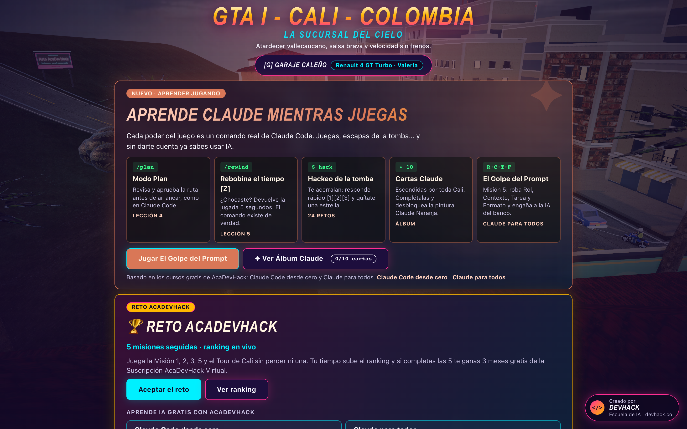
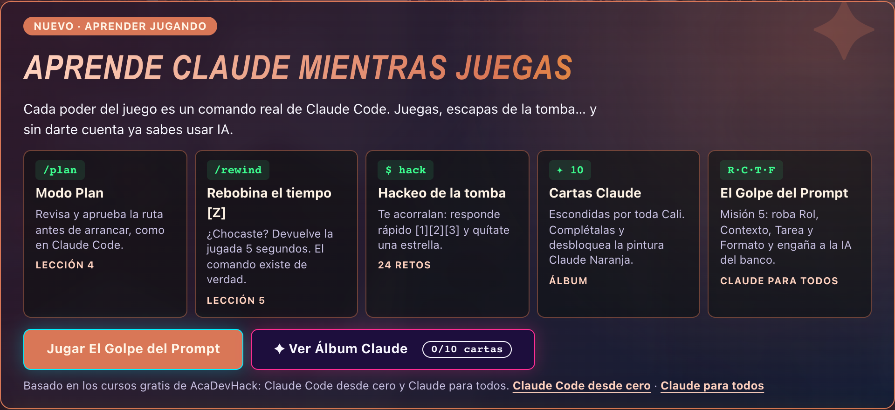
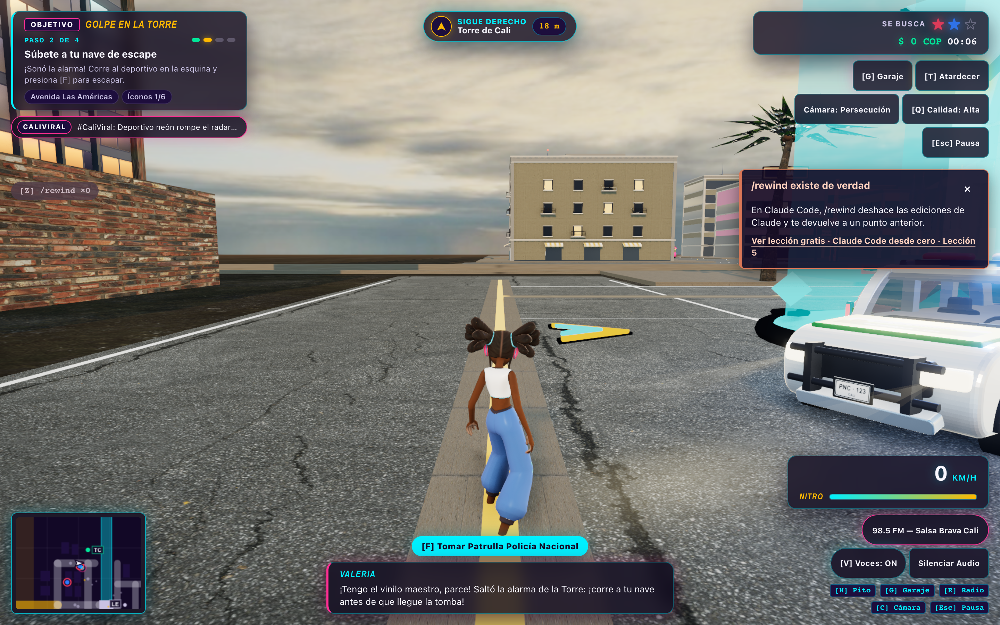
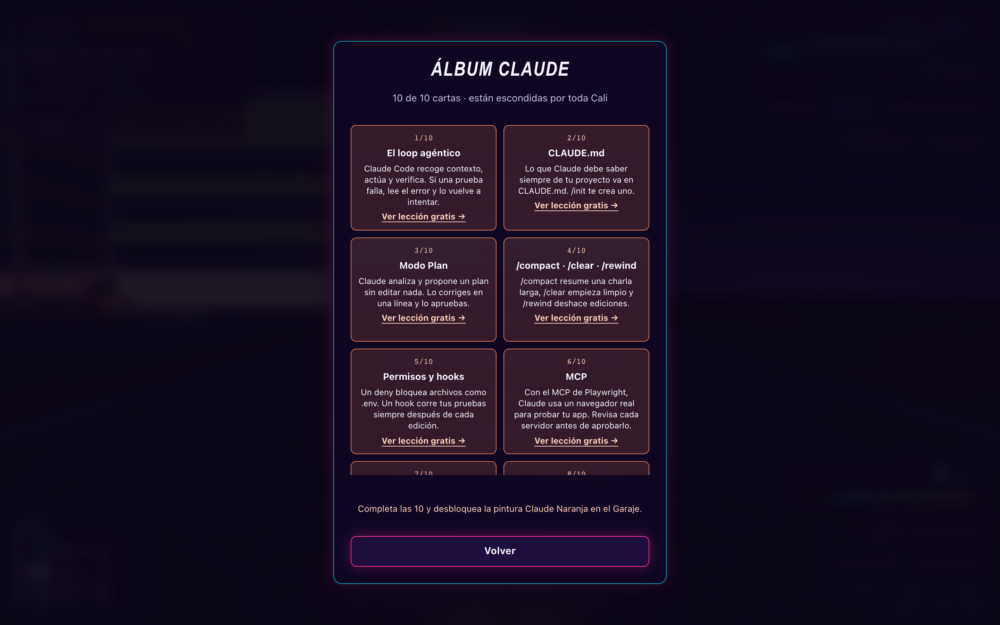
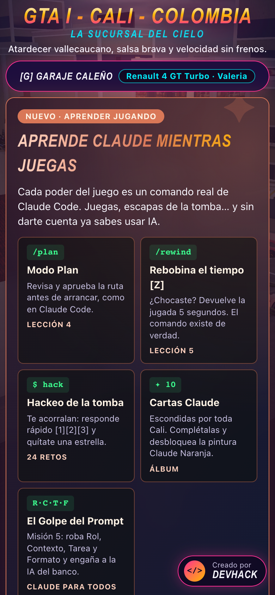

<div align="center">

# 🌴 GTA I - Cali - Colombia

### Aprende Claude mientras juegas

**Maneja por Santiago de Cali, escápate de la tomba y aprende Claude Code y Claude sin darte cuenta.**<br/>
Juego 3D gratis en el navegador · Creado por **[DevHack](https://devhack.co)**, la escuela de IA de Cali.

[**▶ Jugar**](#-jugar-en-local) · [**🧠 Qué aprendes**](#-aprende-claude-mientras-juegas) · [**🏆 Reto AcaDevHack**](#-reto-acadevhack) · [**🎓 Cursos gratis**](https://devhack.co/academy-ai/claude-code-desde-cero/)



</div>

---

## 🧠 Aprende Claude mientras juegas

Aquí nadie te da una clase. **Cada poder del juego es un comando real de Claude Code**: lo usas para escapar de la policía y, cuando abras Claude Code, ya sabes qué hace.



| En el juego | Qué hace | Lo que aprendes de verdad |
|---|---|---|
| **Modo Plan** | Antes de cada misión revisas el plan y eliges **Turbo** (nitro lleno) o **Discreto** (una estrella menos) | El **modo Plan** de Claude Code: proponer antes de tocar código · *Lección 4* |
| **`/rewind` [Z]** | ¿Chocaste? Vuelves 5 segundos atrás | **`/rewind`** deshace las ediciones de Claude · *Lección 5* |
| **Hackeo de la tomba** | Si la policía te acorrala, respondes en 8 segundos con [1] [2] [3]. Si aciertas, pierdes una estrella | 24 preguntas sacadas de los exámenes de los cursos |
| **Cartas Claude ✦** | 10 cartas escondidas por toda Cali; con el álbum completo desbloqueas la pintura **Claude Naranja** | Loop agéntico, CLAUDE.md, hooks, MCP, subagentes, skills, artifacts… |
| **Misión 5 · El Golpe del Prompt** | Robas **Rol, Contexto, Tarea y Formato** y engañas a la IA de un banco | El método de 4 piezas para pedirle bien a Claude · *Claude para todos* |
| **Radio IA 99.1** + celular | Cuñas caleñas en la radio y tips del *Profe JG* después de cada misión | Trucos del día a día con Claude |

Cada tip trae un link a la lección gratis de [AcaDevHack](https://devhack.co).

<table>
  <tr>
    <td><br/><sub><b>Modo Plan</b>: apruebas la ruta antes de arrancar</sub></td>
    <td><br/><sub><b>/rewind [Z]</b>: vuelves 5 segundos atrás</sub></td>
  </tr>
  <tr>
    <td><br/><sub><b>Hackeo de la tomba</b>: respondes y te quitas una estrella</sub></td>
    <td><br/><sub><b>Misión 5</b>: Rol, Contexto, Tarea y Formato</sub></td>
  </tr>
  <tr>
    <td><br/><sub><b>Álbum Claude</b>: 10 cartas, una por lección</sub></td>
    <td><br/><sub><b>Garaje</b>: la pintura Claude Naranja se desbloquea con el álbum completo</sub></td>
  </tr>
</table>

## 🏆 Reto AcaDevHack

Juega **las 5 misiones seguidas**: Misión 1 → 2 → 3 → 5 → Tour de Cali. Si te agarran, vuelves a empezar desde la Misión 1.

- Elige un nickname y compite en el **ranking en vivo**, con el mejor tiempo por misión.
- Si las completas todas, ganas **3 meses gratis de la Suscripción AcaDevHack Virtual**: recibes un código y lo reclamas por WhatsApp.

## 🎮 Las misiones

| # | Misión | De qué se trata |
|---|---|---|
| 1 | **Golpe en la Torre** | Robo a pie frente a la Torre de Cali y escape hasta San Antonio |
| 2 | **Noche de Salsa en Cristo Rey** | Contrarreloj nocturna de 95 s con la tomba detrás |
| 3 | **Pique Callejero en el Bulevar** | Carrera contra rivales por 6 puntos de control |
| 5 | **El Golpe del Prompt** | Arma el prompt perfecto y entrégaselo a la IA del Banco Sucursal IA |
| — | **Modo Libre** | Recorre los 6 íconos de Cali, busca las Cartas Claude y escucha salsa |

**Controles:**

| Tecla | Acción |
|---|---|
| `WASD` / flechas | Manejar o caminar |
| `Shift` | Nitro / correr |
| `F` | Subir o bajar del carro |
| `Z` | `/rewind` |
| `1` `2` `3` | Responder el hackeo |
| `G` | Garaje |
| `R` | Radio |
| `C` | Cámara |
| `Esc` | Pausa y Álbum Claude |

<p align="center"></p>

## ▶ Jugar en local

```bash
npm install
npm run dev -- --port 4173   # abre http://localhost:4173
```

El juego funciona **100 % offline**: todo el 3D, el audio y las voces son locales. Solo el ranking del Reto usa Firestore, y es opcional.

**Calidad:**

```bash
npm test                     # Vitest: unitarias + integración + piloto automático que completa cada misión
npm run typecheck && npm run lint
npx playwright test --config=tests/e2e/playwright.config.mjs   # E2E en Chromium (servidor en :4173)
npm run build
```

**Capturas del README:**

```bash
node scripts/capture-readme-shots.mjs   # con el servidor de desarrollo corriendo
```

**Stack:** TypeScript · Three.js · Vite · Web Audio + Web Speech (voces `es-CO`) · Firebase (ranking) · Vitest · Playwright.

## 🎓 Sigue aprendiendo (gratis)

- **[Claude Code desde cero](https://devhack.co/academy-ai/claude-code-desde-cero/)**: para programadores. Plan mode, CLAUDE.md, hooks, MCP, subagentes y skills.
- **[Claude para todos](https://devhack.co/academy-ai/claude-para-todos/)**: sin programar. Prompts de 4 piezas, archivos, artifacts, proyectos y privacidad.

---

<div align="center">

Hecho con ❤️ en Cali por **[DevHack](https://devhack.co)** · Escuela de IA aplicada

<sub>Proyecto de fans sin fines de lucro, inspirado en el género de mundo abierto. No está afiliado a Rockstar Games ni a Take-Two Interactive. Licencias de los assets en <a href="public/ASSETS_LICENSE.md">public/ASSETS_LICENSE.md</a>.</sub>

</div>
