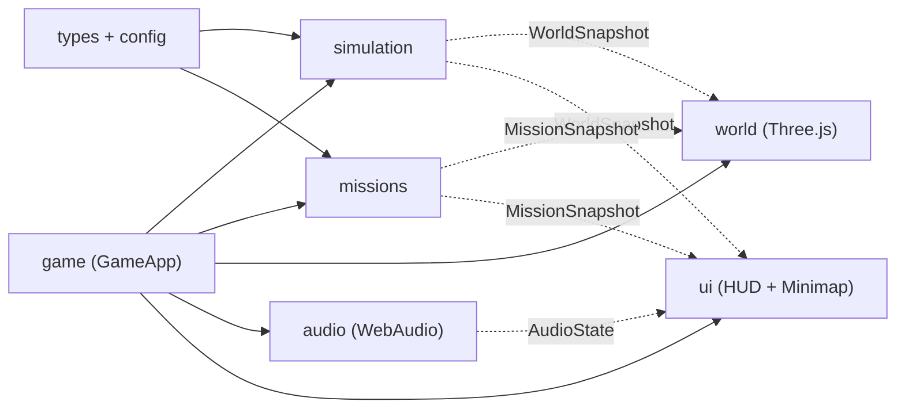

## Design
Feature UI deltas referencing root [DESIGN.md](../../DESIGN.md) tokens (`data-source: local-client-simulation`).

- **Title Screen (`z-40`)**: Full-bleed twilight sky/palm backdrop (`{colors.surface}`) with bold condensed italic headline (`{typography.scale.display}`), 3 primary/secondary launch buttons (`Mission 1`, `Mission 2`, `Free Roam`, `>=44px` height, `empty` badge when no `localStorage` best time exists), and a frosted `{colors.surface_glass}` Controls summary card (`WASD`/Arrows, `Space` Drift, `Shift` Nitro, `F` Vehicle, `R` Radio, `Esc` Pause).
- **Gameplay HUD (`z-10`/`z-20`, `pointer-events: none` on passive containers; `16px` edge inset, `8px` `<640px`)**:
  - **Top-Left**: Active mission objective `hud_panel` + `CaliViral` live ticker pill (`{colors.primary}` border).
  - **Top-Right**: Wanted Stars (`1–3` stars alternating `{colors.police_red}`/`{colors.police_blue}`, static under `prefers-reduced-motion`) + `$ COP` cash + `tabular-nums` mission timer (`{typography.font_mono}`).
  - **Bottom-Left**: Rectangular 2D GPS Minimap canvas (`180x132px` desktop, `128x96px` `<640px`, `{rounded.md}`, `{colors.border}`) plotting Cali streets, river, landmarks, police, and active objective blip.
  - **Bottom-Center (`z-20`)**: Context `[F]` enter/exit vehicle pill + Valeria/Mateo dialogue toast (`{colors.surface_glass}`, max `520px`, auto-stacks cleanly above mobile controls).
  - **Bottom-Right**: `km/h` Speedometer (`{typography.font_mono}`), Nitro gauge (`{colors.secondary}`/`{colors.warning}`), Radio FM clickable pill (`pointer-events: auto`), and compact keycap hint (hidden `<640px`).
- **Overlays (`z-30`/`z-40`)**:
  - **Pause Menu**: Frosted modal with `Resume`, `Restart`, `Audio/Radio` toggle, and `Title` actions.
  - **Mission Passed Banner**: Condensed italic `{colors.success}`/`{colors.warning}` banner with `$ COP` reward and time delta.
  - **Busted Retry Modal (`¡Te agarró la tomba!`)**: `{colors.police_red}`/`{colors.police_blue}` split accent border, bust summary, `Retry` (`button_primary`) & `Title` buttons.
  - **Grand Victory Epilogue (`z-40`)**: Full-screen completion summary with total `$ COP`, best times, `Free Roam` & `Replay` triggers.
- **Screen Flow & Interactive States**:
  - Flow: `Title -> Gameplay HUD <-> Pause -> Mission Passed | Busted -> Grand Victory`.
  - Every clickable control implements `default`, `hover`, `focus-visible` (`2px` `{colors.secondary}` ring), `active`, `disabled`, `loading` (scene boot), `empty` (no best score), and `error` (WebGL unsupported fallback card with `{colors.error}` border).

## Architecture
Unidirectional, offline-first architecture (`data-source: local-client-simulation`, `C-01`; see [adr-001](./adr-001-decoupled-3d-simulation.md)).

### Module Boundaries & Dependency Rules
- `src/types/`, `src/config/`: Zero dependencies. Shared immutable contracts (`Vec2`, `InputState`, `WorldSnapshot`, `MissionSnapshot`, `AudioState`, `StorageRecords`), `CALI_MAP` (`-240..+240`, 6 landmarks, Rio Cali + twin bridges, building AABBs), and `LOCALE_CALI` (all Español Caleño player copy isolated here).
- `src/simulation/`: Imports ONLY `src/types/`, `src/config/` (NO `three`, NO DOM). Pure `GameWorld.step(dt, input)` running arcade vehicle/foot physics, AABB/river/bridge collisions, traffic, and Police AI; emits readonly `WorldSnapshot`.
- `src/missions/`: Imports ONLY `src/types/`, `src/config/` (NO `three`, NO DOM, NO `src/simulation/`). Pure `MissionDirector` state machine (`mission_1_bulevar`, `mission_2_cristo_rey`, `free_roam`) + safe `StorageAdapter` for `localStorage` (`gta_cali_records_v1`).
- `src/world/`: Imports `three`, `src/types/`, `src/config/`. Procedural 3D builders (sunset sky, 6 landmarks, vehicles, player, beacons), chase camera, and `WorldRenderer.sync(world, mission, dt)` (zero simulation mutations).
- `src/audio/`: Imports `src/types/`, `src/config/`. Procedural Web Audio `AudioEngine` (Salsa Brava, Synthwave, SFX) with injectable/optional `AudioContext` factory (safe no-op in headless tests).
- `src/ui/`: Imports `src/types/`, `src/config/`. `MinimapRenderer` (2D Canvas GPS) and `HudController` (DOM + `DESIGN.md` tokens, zero game logic).
- `src/game/`: `InputManager` + `GameApp` fixed-dt (`<= 0.05s`) `requestAnimationFrame` composition root + readonly `window.__GTA_CALI__` inspection snapshot.

### Core Contracts
- `GameWorld.step(dt, input): Readonly<WorldSnapshot>` — player mode/pose, vehicles, traffic, police, wanted stars (`0..3`), bust meter, speed, nitro, nearby vehicle prompt.
- `MissionDirector.update(world, dt): Readonly<MissionSnapshot>` — mode, screen state, active objective/checkpoint, `$ COP` cash, timer/best times, dialogue/ticker IDs.
- `StorageAdapter`: `loadRecords()` / `saveBestTime(missionId, seconds)` with JSON validation and silent in-memory fallback on quota/unavailable storage.

### Review checklist
**Wiring map (`data-source: local-client-simulation`)**
| Screen / Surface | State / Controller | Real Source | Status |
| :--- | :--- | :--- | :--- |
| Title / Pause / Passed / Busted / Victory | `HudController` + `MissionDirector` | `MissionSnapshot` + `localStorage` (`gta_cali_records_v1`) | build in C-01 |
| HUD (Objective, Ticker, Wanted, Cash, Timer, Speed, Nitro, Radio, Dialogue) | `HudController` | `GameWorld.getSnapshot()` + `MissionDirector.getSnapshot()` + `AudioEngine.getState()` | build in C-01 |
| 2D GPS Minimap | `MinimapRenderer` | `CALI_MAP` + `WorldSnapshot` + `MissionSnapshot.activeObjective` | build in C-01 |
| 3D WebGL Viewport | `WorldRenderer.sync()` | `WorldSnapshot` + `MissionSnapshot` + procedural Three.js scene | build in C-01 |
| Inspection Hook (`window.__GTA_CALI__`) | `GameApp` | Readonly `{ mode, world, mission, audio }` snapshot | build in C-01 |

**Verifiable rules**
1. `src/simulation/` and `src/missions/` never import `three`, `window`, `document`, `src/world/`, `src/audio/`, or `src/ui/`.
2. `src/world/` and `src/ui/` never mutate simulation or mission state directly; all actions route through `GameApp` callbacks.
3. Zero external network/CDN fetches; all 3D geometry, textures, fonts, and audio are procedural or bundled offline.
4. Player-facing Español Caleño strings live strictly in `src/config/localeCali.ts`; all code, types, comments, and docs are English.
5. `GameApp` clamps `dt <= 0.05s`; `AudioEngine` and `StorageAdapter` degrade cleanly (no-op / fallback) without throwing when headless.
